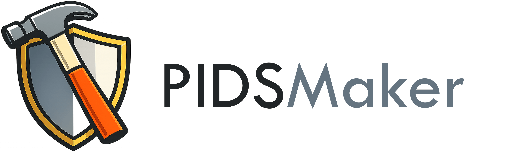
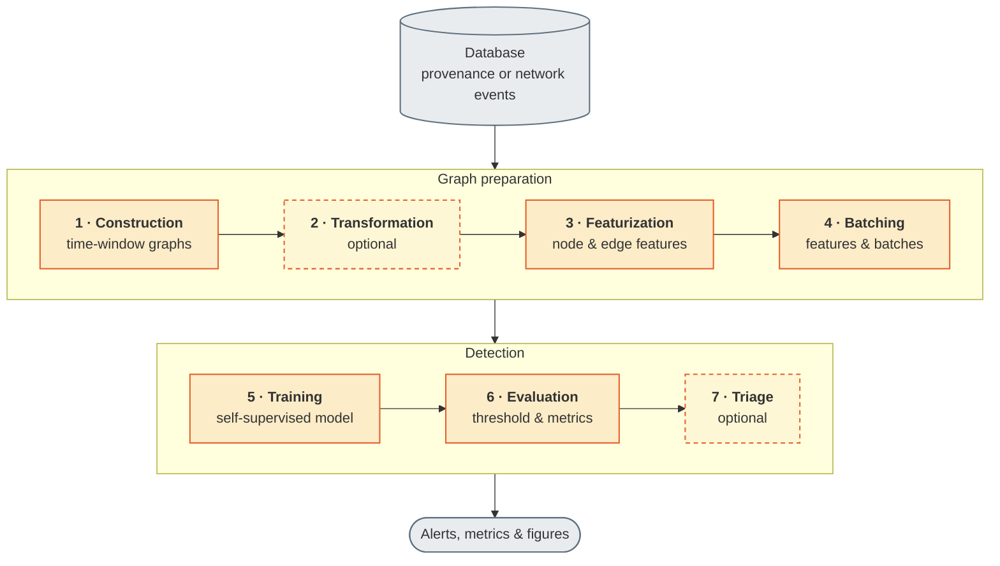
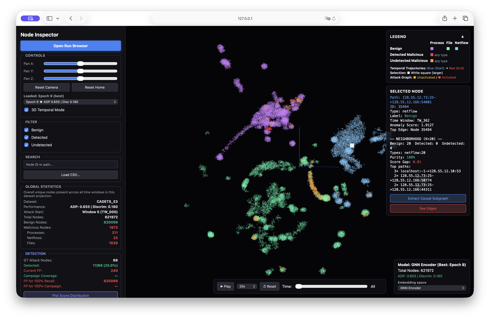

<p align="center">
  
</p>

<h3 align="center">
  Build, run and customize deep learning intrusion detection systems on provenance and network graphs
</h3>

<div align="center">

[](https://ubc-provenance.github.io/PIDSMaker/)
[](https://github.com/ubc-provenance/PIDSMaker/releases)
[](https://github.com/ubc-provenance/PIDSMaker/actions/workflows/tests.yml)
[](https://ubc-provenance.github.io/PIDSMaker/getting-started/installation/)
[](https://huggingface.co/pidsmaker)
[](https://doi.org/10.5281/zenodo.19813646)
[](https://github.com/ubc-provenance/PIDSMaker/blob/main/LICENSE)
[](https://discord.gg/jecmkTABUg)
[](https://github.com/ubc-provenance/PIDSMaker/stargazers)

</div>

<p align="center">
  <strong>
    <a href="https://ubc-provenance.github.io/PIDSMaker/">📘 Documentation</a>
    &nbsp;|&nbsp;
    <a href="https://www.usenix.org/conference/usenixsecurity25/presentation/bilot">📄 Experiments Paper</a>
    &nbsp;|&nbsp;
    <a href="https://dl.acm.org/doi/10.1145/3770855.3817514">📄 Framework Paper</a>
    &nbsp;|&nbsp;
    <a href="https://tristanbilot.github.io/public_content/slides_pidsmaker.pdf">🎙️ NDSS PRISM'26 Tutorial</a>
    &nbsp;|&nbsp;
    <a href="https://ubc-provenance.github.io/PIDSMaker/getting-started/installation/">⚙️ Installation</a>
  </strong>
</p>

---

The first framework to build and experiment with deep learning graph-based intrusion detection systems, on **host provenance** (PIDSs) and **network events** (NIDSs).
A single codebase and pipeline runs 17 state-of-the-art systems on 17 datasets of both families, and makes them easy to customize into new variants.


## 💻 Installation (Linux/macOS)

PIDSMaker is a Python package, for Python 3.9 to 3.11. Its datasets are Parquet files, downloaded from [Hugging Face](https://huggingface.co/datasets/pidsmaker/datasets) and read in place with DuckDB: nothing else to set up.

```shell
conda create -n pids python=3.11 && conda activate pids
pip install pidsmaker
pidsmaker velox CADETS_E3
```

The [installation guide](https://ubc-provenance.github.io/PIDSMaker/getting-started/installation/) covers the GPU and CPU builds of PyTorch, where datasets and artifacts are stored, macOS and [HPC clusters](https://ubc-provenance.github.io/PIDSMaker/getting-started/installation/#hpc-clusters).

PIDSMaker runs on Linux with or without an NVIDIA GPU, and on [macOS](https://ubc-provenance.github.io/PIDSMaker/getting-started/installation/#macos) (Apple Silicon) on CPU, for most datasets: a laptop with 32 GB of RAM is ideal. The largest datasets (`TRACE_E3` and the E5 datasets) need a server.


## Release notes

| Version | Date | Highlights |
|---------|------|------------|
| [5.0.0](https://github.com/ubc-provenance/PIDSMaker/releases/tag/5.0.0) | Nov 2026 | [`pip install pidsmaker`](https://ubc-provenance.github.io/PIDSMaker/getting-started/installation/) and the `pidsmaker` command. Datasets as Parquet files from Hugging Face, read with DuckDB: no database server or Docker. [ShadeWatcher and ProGrapher](https://ubc-provenance.github.io/PIDSMaker/guide/systems/). [Network intrusion detection](https://ubc-provenance.github.io/PIDSMaker/guide/systems/): Euler, Argus, Jbeil, LARES, E-GraphSAGE and Anomal-E, on LANL and OpTC flows. [Faster, leaner pipeline](https://ubc-provenance.github.io/PIDSMaker/guide/pipeline/#performance) with identical results (Orthrus on THEIA_E5: ~3.4 h → ~61 min, 370 → 16.6 GB of RAM). [Runs on macOS](https://ubc-provenance.github.io/PIDSMaker/getting-started/installation/#macos) (Apple Silicon, on CPU) |
| [4.0.0](https://github.com/ubc-provenance/PIDSMaker/releases/tag/4.0.0) | Nov 2026 | Unified tokenization (`featurization.tokenization`, renamed tokenizer arguments), configurable graph cleaning (`construction.cleaning`), fixed queue, time-window and node-time-window evaluations, MAGIC kNN fix |
| [3.0.0](https://github.com/ubc-provenance/PIDSMaker/releases/tag/3.0.0) | Oct 2026 | Pretrained encoders (SPIDER, CyberGFM, language models, self-supervised GNNs) as node featurization for any PIDS, `stable_optim` to reduce instability, upgrade many packages including torch 1.13.1 (CUDA 11.7) => 2.1.2 (CUDA 12.1) |
| [2.2.0](https://github.com/ubc-provenance/PIDSMaker/releases/tag/2.2.0) | Jul 2026 | Interactive 3D embedding viewer, ThreaTrace ground truth |
| [2.1.1](https://github.com/ubc-provenance/PIDSMaker/releases/tag/2.1.1) | May 2026 | State of the repo for the KDD'26 paper, improved Velox |
| [2.1.0](https://github.com/ubc-provenance/PIDSMaker/releases/tag/2.1.0) | Apr 2026 | Carbanak v2 and Atlas v2 datasets, dataset download script, Docker and W&B fixes |
| [2.0.0](https://github.com/ubc-provenance/PIDSMaker/releases/tag/2.0.0) | Jan 2026 | FIVEDIRECTIONS and TRACE datasets, tuned hyperparameters, simplified pipeline stages (renamed arguments) |
| [1.0.1](https://github.com/ubc-provenance/PIDSMaker/releases/tag/1.0.1) | Oct 2025 | Deterministic graph construction and word2vec, REAPr labels, Apptainer installation, dataset preprocessing scripts |
| [1.0.0](https://github.com/ubc-provenance/PIDSMaker/releases/tag/1.0.0) | Jun 2025 | Initial release, with 8 PIDSs and the DARPA TC and OpTC datasets |

See the [releases](https://github.com/ubc-provenance/PIDSMaker/releases) for the full notes.


## Supported Systems

The framework currently integrates the following provenance-based (PIDS) and network (NIDS) intrusion detection systems. They are described with the same components, and most of them [run on both kinds of datasets](https://ubc-provenance.github.io/PIDSMaker/guide/systems/#running-across-families).

| System      | Family     | Venue                        | Paper |
|-------------|------------|------------------------------|-------|
| Velox       | Provenance | USENIX Security 2025         | [Link](https://tfjmp.org/publications/2025-usenixsec-2.pdf) |
| Orthrus     | Provenance | USENIX Security 2025         | [Link](https://www.usenix.org/system/files/conference/usenixsecurity25/sec25cycle1-prepub-103-jiang-baoxiang.pdf) |
| OCR-APT     | Provenance | ACM CCS 2025                 | [Link](https://arxiv.org/pdf/2510.15188) |
| R-Caid      | Provenance | IEEE S&P 2024                | [Link](https://gangw.web.illinois.edu/rcaid-sp24.pdf) |
| Flash       | Provenance | IEEE S&P 2024                | [Link](https://dartlab.org/assets/pdf/flash.pdf) |
| Kairos      | Provenance | IEEE S&P 2024                | [Link](https://arxiv.org/pdf/2308.05034) |
| Magic       | Provenance | USENIX Security 2024         | [Link](https://www.usenix.org/system/files/usenixsecurity24-jia-zian.pdf) |
| NodLink     | Provenance | NDSS 2024                    | [Link](https://arxiv.org/pdf/2311.02331) |
| ProGrapher  | Provenance | USENIX Security 2023         | [Link](https://www.usenix.org/system/files/usenixsecurity23-yang-fan.pdf) |
| ThreaTrace  | Provenance | IEEE TIFS 2022               | [Link](https://arxiv.org/pdf/2111.04333) |
| ShadeWatcher | Provenance | IEEE S&P 2022               | [Link](https://jun-zeng.github.io/file/shadewatcher_paper.pdf) |
| LARES       | Network    | ACSAC 2026                   | [Link](https://ora.ox.ac.uk/objects/uuid:07b7d2a5-91f8-4c37-a90c-4ca615b428a7/files/ss7526g13z) |
| Argus       | Network    | IEEE S&P 2024                | [Link](https://doi.org/10.1109/SP54263.2024.00012) |
| Jbeil       | Network    | IEEE S&P 2024                | [Link](https://doi.org/10.1109/SP54263.2024.00009) |
| Euler       | Network    | NDSS 2022                    | [Link](https://doi.org/10.14722/ndss.2022.24107) |
| E-GraphSAGE | Network    | IEEE/IFIP NOMS 2022          | [Link](https://arxiv.org/abs/2103.16329) |
| Anomal-E    | Network    | Knowledge-Based Systems 2022 | [Link](https://arxiv.org/abs/2207.06819) |

## Supported Datasets

### Provenance datasets

System events of hosts, with the attack nodes as ground truth, available as preprocessed datasets downloaded with `pidsmaker download` (size of their Parquet files below).

| Dataset | OS | Attacks | Nodes | Events | Size (GB) |
|---------|------|--------:|------:|-------:|----------:|
| CADETS_E3 | FreeBSD | 3 | 2.68M | 36.5M | 1.3 |
| THEIA_E3 | Linux | 2 | 1.26M | 44.4M | 0.71 |
| CLEARSCOPE_E3 | Android | 1 | 369K | 18.3M | 0.51 |
| FIVEDIRECTIONS_E3 | Windows | 2 | 1.38M | 78.9M | 2.3 |
| TRACE_E3 | Linux | 3 | 44.5M | 284M | 9.4 |
| CADETS_E5 | FreeBSD | 2 | 15.2M | 1.08B | 32.9 |
| THEIA_E5 | Linux | 1 | 2.29M | 141M | 3.9 |
| CLEARSCOPE_E5 | Android | 2 | 501K | 199M | 5.0 |
| FIVEDIRECTIONS_E5 | Windows | 4 | 18.8M | 1.09B | 30.3 |
| TRACE_E5 | Linux | 1 | 72.3M | 2.64B | 74.3 |
| optc_h201 | Windows | 1 | 5.27M | 38.2M | 1.6 |
| optc_h501 | Windows | 1 | 3.96M | 28.0M | 1.2 |
| optc_h051 | Windows | 1 | 4.62M | 31.6M | 1.3 |
| ATLASV2_EDR | Windows | 10 | 664K | 2.70M | 0.16 |
| CARBANAKV2_EDR | Windows + Linux | 1 | 4.15M | 17.1M | 1.1 |

### Network datasets

Authentications or flows between hosts, with labelled malicious events, built from the preprocessed files of [LARES](https://github.com/TristanBilot/lares) ([details](https://ubc-provenance.github.io/PIDSMaker/guide/datasets/#network-datasets)), and downloaded the same way.

| Dataset | Events | Hosts | Malicious events | Size (GB) |
|---------|--------|------:|-----------------:|----------:|
| LANL | 49.3M NTLM authentications | 15,610 | 705 | 0.40 |
| OPTC_NET | 1.86B network flows | 625 | 5,165 | 11.8 |

## Pretrained Encoders

Any provenance-based system can replace its node featurization (e.g. `word2vec`) by an encoder pretrained on provenance data.

| Encoder | Description |
|---------|-------------|
| [SPIDER](https://tfjmp.org/publications/2026-neurips.pdf) (NeurIPS 2026) | transformer entity encoder distilled from a GNN teacher, with [pretrained weights](https://ubc-provenance.github.io/PIDSMaker/features/pretrained_encoders/#pretrained-weights) |
| [CyberGFM](https://arxiv.org/abs/2601.05988) | BERT pretrained on random walks, then fine-tuned as a detector |
| [GPT-2](https://cdn.openai.com/better-language-models/language_models_are_unsupervised_multitask_learners.pdf), [Llama 3.2](https://huggingface.co/meta-llama/Llama-3.2-1B), [OPT](https://arxiv.org/abs/2205.01068) | General-purpose language models fine-tuned on entity labels |
| [BERT](https://arxiv.org/abs/1810.04805), [RoBERTa](https://arxiv.org/abs/1907.11692), [ModernBERT](https://arxiv.org/abs/2412.13663), [LogBERT](https://arxiv.org/abs/2103.04475), [Llama](https://arxiv.org/abs/2302.13971) | Language models trained from scratch on random walks |
| [GraphMAE](https://arxiv.org/abs/2205.10803), [GAE](https://arxiv.org/abs/1611.07308), [DGI](https://arxiv.org/abs/1809.10341), [DeepWalk](https://arxiv.org/abs/1403.6652), [node2vec](https://arxiv.org/abs/1607.00653) | Self-supervised GNNs and walk embeddings |


See the [documentation](https://ubc-provenance.github.io/PIDSMaker/features/pretrained_encoders/) to download the weights, pretrain an encoder and fine-tune it as a detector.

## 📄 Documentation

A [comprehensive documentation](https://ubc-provenance.github.io/PIDSMaker/) is available, explaining all possible arguments and providing examples on how integrating new systems.

### Pipeline

The framework integrates a [pipeline](https://ubc-provenance.github.io/PIDSMaker/guide/pipeline/) composed of seven stages, shared by provenance and network systems, each parameterizable via configurable arguments, enabling flexible customization of new systems.




## 🧪 Basic usage of the framework

Once you have followed the installation guidelines, you can experiment in multiple ways.
Replace `SYSTEM` by a provenance system (`velox`, `orthrus`, `nodlink`, `threatrace`, `kairos`, `rcaid`, `flash`, `magic`, `ocrapt`) or a network system (`euler`, `argus`, `jbeil`, `lares`, `egraphsage`, `anomal_e`), and `DATASET` by a provenance (e.g. `CADETS_E3`) or network (`LANL`, `OPTC_NET`) dataset.

1. Run in the shell:
    ```shell
    pidsmaker SYSTEM DATASET
    ```

2. Run in the shell, monitored to weights & biases (W&B):
    ```shell
    pidsmaker SYSTEM DATASET --wandb
    ```

3. Run in background, monitored to W&B (recommended for multiple parallel runs and for research):
    ```shell
    pidsmaker SYSTEM DATASET --wandb --background
    ```
    The command prints the log file of the run (`pidsmaker_SYSTEM_DATASET_<time>.log`, in the current folder): follow it with `tail -f`.

`pidsmaker` sets `PYTHONHASHSEED=0` and `CUBLAS_WORKSPACE_CONFIG=:4096:8` for reproducible runs.

We generally using using W&B for experiment monitoring and historization (see installation guidelines). 

**Warning:** Before performing evaluations, you should tune all systems (see docs [here](https://ubc-provenance.github.io/PIDSMaker/features/tuning/)).

## Reproducing results

PIDSs and NIDSs exhibit significant instability—that is, high sensitivity to training perturbations—due to their self-supervised training nature. 
Running the same configuration with different random seeds or minor hyperparameter changes often yields substantially different results. 
Consequently, reproducing results as the framework evolves presents a real challenge.

We recommend [running each system multiple times](https://ubc-provenance.github.io/PIDSMaker/features/instability/) to increase the likelihood of obtaining a run with good metrics. Alternatively, you can perform [hyperparameter tuning](https://ubc-provenance.github.io/PIDSMaker/features/tuning/) for each system.

`--training.stable_optim=True` (AdamW, warmup and cosine learning rate schedule, gradient clipping) is designed to [reduce this instability](https://ubc-provenance.github.io/PIDSMaker/features/instability/#reducing-instability).

## Customize existing systems

The default configuration files in `config/*.yml` represent the architecture of existing PIDSs and NIDSs in YAML format. They contain the original hyperparameters used by each system. 

The main strength of PIDSMaker is the customization of existing systems for easy experimentation. 
A few examples below.

### From CLI

<i>Running Kairos with embedding size of 128 instead of 100, and last neighbor sampling set to last 10 neighbors instead of 20.</i>

```shell
pidsmaker kairos CADETS_E3 \
  --training.node_hid_dim=128 \
  --batching.intra_graph_batching.tgn_last_neighbor.tgn_neighbor_size=10
```

<i>Running Orthrus with Doc2vec instead of word2vec, and 3 GraphSAGE layers instead of 2 attention layers.</i>

```shell
pidsmaker orthrus CADETS_E3 \
  --featurization.used_method=doc2vec \
  --featurization.emb_dim=128 \
  --training.encoder.used_methods=tgn,sage \
  --training.encoder.sage.num_layers=3
```

### From a new YAML config file

Want to create a new system? Create a new config under `config/your_system.yml`, inherit from existing systems and tune it as you want.

<i>Magic with node type prediction instead of its hybrid masked feature reconstruction and structure prediction objective function, and use a 2-layer MLP with ReLU as decoder, and use NodLink's thresholding method.</i>

``` yaml
_include_yml: magic

training:
  decoder:
    used_methods: predict_node_type
    predict_node_type:
      node_mlp:
        architecture_str: linear(0.5) | relu

evaluation:
  node_evaluation:
    threshold_method: nodlink
```

### Interactive embedding viewer

PIDSMaker also ships an interactive 3D web viewer for exploring a run's node
embeddings — temporal playback, per-node inspection, attack-graph overlays, and
switching between the featurization and GNN-encoder spaces. Train a run with
`--save_for_viz` to persist the artifacts it needs, then launch it (see the
[web viewer README](https://github.com/ubc-provenance/PIDSMaker/blob/main/pidsmaker/vizgen/web/README.md)):

```bash
python -m pidsmaker.vizgen.web.viz_server
```



## Hyperparameter tuning

PIDSMaker supports easy hyperparameter tuning for existing or new models. 
Follow the [instructions](https://ubc-provenance.github.io/PIDSMaker/features/tuning/) available in our documentation.

You can specify the range of hyperparameters to search in a yaml config.

```yaml
method: grid 

parameters:
  training.lr:
    values: [0.001, 0.0001]
  training.node_hid_dim:
    values: [32, 64, 128, 256]
  featurization.used_method:
    values: [fasttext, word2vec]
```

Then run the framework in tuning mode.

```sh
pidsmaker my_system CADETS_E3 --wandb --background --tuning_mode=hyperparameters
```

Once you find the best hyperparameters, store them in a yaml file and run your tuned model.

```sh
pidsmaker my_system CADETS_E3 --wandb --background --tuned
```

## Citation

If you use this work, please cite the two following papers:
```
@inproceedings{bilot2026pidsmaker,
  title={PIDSMaker: Building and Evaluating Provenance-based Intrusion Detection Systems},
  author={Bilot, Tristan and Jiang, Baoxiang and Pasquier, Thomas},
  booktitle={Proceedings of the 32nd ACM SIGKDD Conference on Knowledge Discovery and Data Mining (KDD '26)},
  year={2026}
}
@inproceedings{bilot2025simpler,
	title={{Sometimes Simpler is Better: A Comprehensive Analysis of State-of-the-Art Provenance-Based Intrusion Detection Systems}},
	author={Bilot, Tristan and Jiang, Baoxiang and  Li, Zefeng and  El Madhoun, Nour and Al Agha, Khaldoun and Zouaoui, Anis and Pasquier, Thomas},
	booktitle={Security Symposium (USENIX Sec'25)},
	year={2025},
	organization={USENIX}
}
```

## Contributing

Pull requests are welcome! Please follow the [contribution guidelines](https://ubc-provenance.github.io/PIDSMaker/community/contributing/).

Questions, ideas or feature requests? Join our [Discord](https://discord.gg/jecmkTABUg).

## Support and Funding

<p align="center">
  <a href="https://www.amazon.science/research-awards/recipients/thomas-pasquier" target="_blank"></a>
  <a href="https://www.cs.ubc.ca/news/2026/01/thomas-amazon-cyberthreats" target="_blank"></a>
</p>

## License

See [licence](https://github.com/ubc-provenance/PIDSMaker/blob/main/LICENSE).
