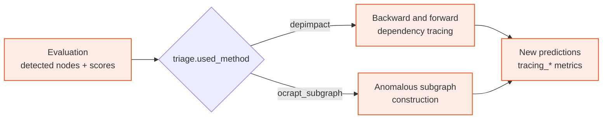

# Triage

Detection flags individual nodes, but an analyst needs to know **how** an attack unfolded. Triage, the last stage of the [pipeline](../guide/pipeline.md), starts from the detected nodes and reconstructs the attack around them, which can also discard isolated false positives.
{ .lead }

Two methods are available, selected with `triage.used_method`:

| Method | Idea | Works with |
|---|---|---|
| `depimpact` | Traces the dependencies of each detected node backward to its entry points and forward to its exit points, and keeps the most suspicious paths | `node_evaluation`, `node_tw_evaluation` |
| `ocrapt_subgraph` | Groups detected nodes into connected subgraphs around the most anomalous seeds, and keeps the most severe subgraphs | `node_evaluation` |

Triage starts from node-level detections: it applies to provenance systems, and to any system evaluated with `node_evaluation` (or `node_tw_evaluation` for DepImpact). The edge-level and host-centered evaluations of network systems are not triaged. OCR-APT runs with its subgraph triage on LANL in the tests (`tests/test_network_datasets.py`); DepImpact, which traces causal dependencies in provenance graphs, is not tested on network datasets.

Triage is **off by default** in every system except OCR-APT. Its arguments have no default values: when you enable a method, set all of its arguments, on the CLI or in the YAML config.
Triage only runs after evaluation, and changing its arguments re-runs triage alone (see [Caching of tasks](../guide/pipeline.md#caching-of-tasks)).



## DepImpact

Each node flagged as malicious is a **point of interest** (POI), processed in its time-window graph.

<ol class="pm-steps" markdown>
<li markdown>**Scoring.** Every node of the graph gets a score, set by `score_method`: `degree` (out-degree divided by in-degree), `recon_loss` (its anomaly score from evaluation), or `degree_recon` (the sum of both, min-max normalized).</li>
<li markdown>**Dependency graph.** The time-window graph is turned into a DAG ordered by time: a node that receives a new edge gets a new version, so that paths always move forward in time.</li>
<li markdown>**Backward tracing.** From the POI to the **entry points** of the DAG (nodes without incoming edges). Each entry point is scored by the mean score of the nodes between it and the POI, and the best-scored entries are kept.</li>
<li markdown>**Forward tracing.** The same, from the POI to the **exit points** (nodes without outgoing edges).</li>
<li markdown>**New predictions.** All nodes of the kept paths are predicted malicious, and the metrics are recomputed.</li>
</ol>

`used_method` sets how the nodes between an entry (or exit) point and the POI are collected:

| `triage.depimpact.used_method` | Nodes kept |
|---|---|
| `component` | All nodes on any path between the entry/exit point and the POI |
| `shortest_path` | Only the nodes of the shortest path |
| `1-hop`, `2-hop`, `3-hop` | No tracing: the undirected *n*-hop neighborhood of the POI |

```shell
python pidsmaker/main.py velox CADETS_E3 \
  --triage.used_method=depimpact \
  --triage.depimpact.used_method=component \
  --triage.depimpact.score_method=degree \
  --triage.depimpact.workers=8
```

`workers` is the number of processes that trace POIs in parallel. With `--triage.depimpact.visualize=True`, an image of the reconstructed attack graph is saved for each time window.

!!! warning "Known issues"
    In the current version, `score_method=recon_loss` gives every node a score of 0 (so `degree_recon` behaves like `degree`), and forward tracing with `used_method=shortest_path` finds no path. Use `component` with `degree`.

## OCR-APT subgraphs

This method follows the anomalous subgraph construction of [OCR-APT](https://arxiv.org/abs/2510.15188) (Section 5.2, Algorithm 1). It is enabled by default in the `ocrapt` system.

<ol class="pm-steps" markdown>
<li markdown>**Normalized scores.** The anomaly score of each detected node is normalized to [0, 1] with the range of training losses of its node type.</li>
<li markdown>**Seeds.** For each node type, the `top_k` detected nodes with the highest scores are used as seeds, most anomalous first.</li>
<li markdown>**Expansion.** Each seed is grown with its anomalous neighbors, and, if `num_hops` ≥ 1, with the anomalous neighbors of its neighbors. With `correlate_anomalous_once`, a node joins at most one subgraph. Subgraphs smaller than `min_nodes` are dropped.</li>
<li markdown>**Splitting.** Subgraphs with more than `max_edges` edges are split into Louvain communities and sampled per edge type (`max_edges: 0` disables this).</li>
<li markdown>**Severity.** The severity of a subgraph is the sum of the normalized scores of its anomalous nodes: Negligible (≤ 1), Minor (≤ 10), Moderate (≤ 100), Significant (≤ 1000) or Critical. Only subgraphs at or above `abnormality_level` are kept, and duplicates are removed with `remove_duplicated_subgraph`.</li>
</ol>

The nodes of the kept subgraphs become the new predictions. As in OCR-APT, the metrics are computed with a 2-hop tolerance: a false positive within 2 hops of an attack node is not counted, and an attack node within 2 hops of a true positive counts as detected.

```shell
python pidsmaker/main.py orthrus CADETS_E3 \
  --triage.used_method=ocrapt_subgraph \
  --triage.ocrapt.num_hops=1 --triage.ocrapt.top_k=15 \
  --triage.ocrapt.min_nodes=3 --triage.ocrapt.max_edges=5000 \
  --triage.ocrapt.abnormality_level=Negligible \
  --triage.ocrapt.correlate_anomalous_once=True \
  --triage.ocrapt.remove_duplicated_subgraph=True
```

!!! note
    The score normalization needs the training losses, which are only computed when `training.ocrapt_early_stop.enabled=True`, as in the `ocrapt` config. Without them, every subgraph is *Negligible*: use `abnormality_level=Negligible` on other systems.

## Results

Triage results are logged with a `tracing_` prefix (e.g. `tracing_precision`, `tracing_recall`), next to the metrics of evaluation, which are left unchanged.

- **DepImpact** recomputes all metrics with the new predictions; `ap` and `auc` don't change, since the scores are the same. Its results are saved in the `tracing_graphs/` folder of the triage task: a CSV with, for each POI, the number of true and false positives reached, and the traced subgraphs.
- **OCR-APT** logs the precision, recall, F-score, TP, FP, FN and the number of subgraphs kept.

Both methods use the epoch with the best MCC. All arguments are listed in the [Tasks reference](../reference/tasks.md#stage-7-triage).
