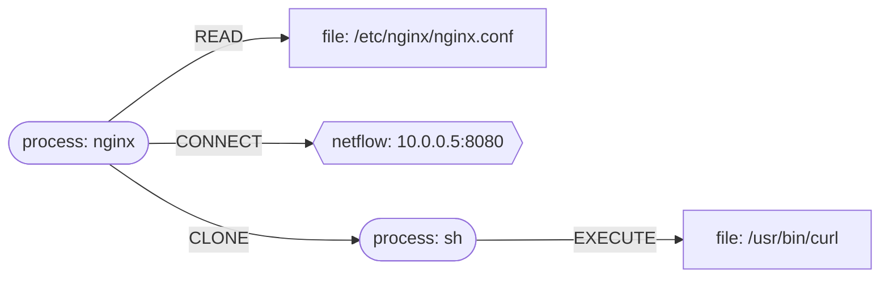
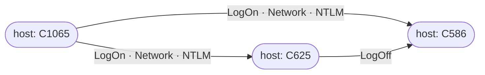
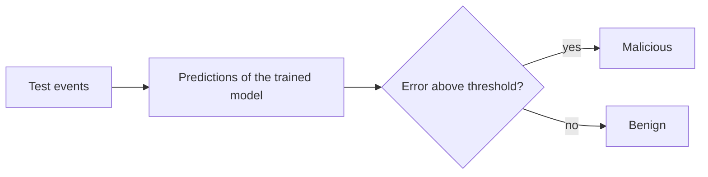
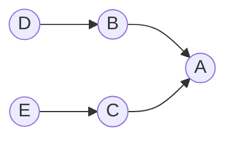

# Background

New to graph-based intrusion detection? This page covers the concepts used throughout the documentation: the two kinds of data that PIDSMaker turns into graphs, system provenance and network events, and how detectors learn from these graphs to find attacks.
{ .lead }

## Two views of an enterprise

Attacks leave traces at two levels. **Inside each host**, the operating system can record what processes do: which files they read and write, which programs they run, which connections they open. **Between hosts**, the network and the authentication services record who connects to whom. PIDSMaker builds a graph from either view, and runs the same pipeline on both:

| | Provenance | Network |
|---|---|---|
| **Records** | System events of a host, from audit frameworks (Linux Audit, ETW) or EDR telemetry | Authentications and network flows between hosts |
| **Nodes** | Processes, files and netflows | Hosts |
| **Edges** | System calls (`EVENT_READ`, `EVENT_EXECUTE`...) | Authentications (`LogOn`, `LogOff`...) or flows (`FLOW_START`) |
| **Node features** | Text labels: paths, command lines, IPs and ports | Host identity |
| **Edge features** | Event type | Event type and attributes: logon type, ports, protocol, size... |
| **Detectors** | Provenance-based IDSs (PIDSs): Velox, Orthrus, Kairos... | Network IDSs (NIDSs): Euler, Argus, LARES... |
| **Typical attacks** | Exploitation, implants, privilege escalation, exfiltration on a host | Lateral movement across the hosts of a network |
| **Ground truth** | Attack nodes, in ground-truth files | Malicious events, labelled in the database |
| **Datasets** | DARPA TC, OpTC, ATLASv2, CARBANAKv2 | LANL, OpTC network flows |

Both views are complementary: provenance shows in detail how a host was compromised, the network shows how an attacker moves between hosts. In PIDSMaker, most detectors designed for one view [run on the other](systems.md#running-across-families).

## Provenance graphs { .pm-h-prov }

**System provenance** is a detailed record of the activity of a computer system. Operating systems can be configured to capture it with their audit frameworks, such as Linux Audit or Event Tracing for Windows (ETW). It captures:

- **Process execution**: which programs ran, with which arguments.
- **File operations**: reads, writes, creations, deletions.
- **Network activity**: connections and data transfers.
- **Inter-process communication**: pipes, signals, shared memory.

Raw provenance logs are turned into a **provenance graph**: a directed graph whose nodes are system entities and whose edges are the interactions between them, with a timestamp.

### Node types

Provenance datasets have three node types, each described by a textual label:

| Type | Entity | Label attributes |
|---|---|---|
| `subject` | Processes and threads | Executable path, command line |
| `file` | Files and directories | File path |
| `netflow` | Network connections | Remote IP address and port |

The attributes used in each label are set with `construction.node_label_features`.

### Edge types

Edges represent system calls or events. The DARPA TC datasets use 10 edge types:

| Edge type | Description |
|---|---|
| `EVENT_READ` | A process reads from a file |
| `EVENT_WRITE` | A process writes to a file |
| `EVENT_OPEN` | A process opens a file |
| `EVENT_EXECUTE` | A process executes a file |
| `EVENT_CONNECT` | A process connects to a remote host |
| `EVENT_RECVFROM` | A process receives network data |
| `EVENT_RECVMSG` | A process receives a network message |
| `EVENT_SENDTO` | A process sends network data |
| `EVENT_SENDMSG` | A process sends a network message |
| `EVENT_CLONE` | A process creates a child process (fork) |

OpTC and the Carbon Black EDR datasets (ATLASv2, CARBANAKv2) have their own event types.

## Network graphs { .pm-h-net }

Network logs record the communications between the hosts of a network: authentications of a user from one computer to another, or flows of packets between two addresses. They are turned into a **network graph**: a directed graph whose nodes are hosts and whose edges are these events, with a timestamp and attributes.

There is a single node type, `host`, identified by its name or ID. Edge types and attributes depend on the dataset:

| Dataset | Edge types | Edge attributes |
|---|---|---|
| `LANL` | Orientation of the authentication: `LogOn`, `LogOff`, `TGS`, `TGT`, `AuthMap`, `ScreenLock`, `ScreenUnlock` (and `FLOW`, if the flows are loaded) | Logon type, authentication type, success, kinds of source and destination users (ports, protocol, duration, packets and bytes of flows) |
| `OPTC_NET` | `FLOW_START` (default), `FLOW_MESSAGE` | Source and destination ports, protocol, size |

`construction.edge_type` can use a categorical attribute as edge type instead, e.g. `logon_type`. All of them are defined in the dataset's schema (`pidsmaker/config/schemas.py`).

Unlike the entities of provenance graphs, hosts have no descriptive label: network detectors learn an embedding of the identity of each host, and rely on the attributes of its events.

## How graph-based IDSs detect attacks

Labeled attacks are rare, so both PIDSs and NIDSs use **self-supervised learning**: they learn what normal activity looks like, then flag what deviates from it.

**1. Training, on benign data only**

**2. Detection, on test data with attacks**

**Training.** The model learns the patterns of normal behavior from benign activity, with a self-supervised task:

=== "Provenance"

    Which processes access which files, how they communicate over the network, which events usually follow each other. PIDSs learn to predict the type of each edge (Velox, Orthrus, Kairos), the type of each node (Flash, ThreaTrace) or to reconstruct node features (MAGIC, NodLink).

=== "Network"

    Which hosts usually authenticate to or connect with which others, and how. NIDSs learn to tell real edges from random ones (link prediction: Euler, Argus, Jbeil, E-GraphSAGE), or to reconstruct the embeddings of edges (LARES).

**Detection.** On the test data, the trained model makes the same predictions. A high error means that the behavior was not seen in training: an entity that suddenly reads unusual files, or a host that logs on to computers it never contacted. Nodes, edges or time windows whose error exceeds a threshold, chosen on validation data, are flagged as malicious.

## How detection is evaluated

Detections are compared with the ground truth of the dataset, at the granularity that fits each view:

- **Provenance** detectors are usually evaluated per **node**: is each process, file or netflow part of an attack? The ground truth lists the attack nodes of each attack.
- **Network** detectors are usually evaluated per **edge**: is each authentication or flow malicious? The ground truth is the label of each event. LARES first selects the most suspicious **hosts**, then their most suspicious edges.

Because attacks are tiny compared to benign activity, metrics that don't depend on a threshold (AUC, AP) and attack-centric metrics (how many attacks are detected, with how many false positives) matter as much as precision and recall. See [Evaluation & labeling](evaluation.md).

## Graph neural networks

Most systems in PIDSMaker use **graph neural networks** (GNNs), neural networks designed for graph-structured data.

GNNs work by **message passing**: at each layer, every node aggregates information from its neighbors to update its representation. After *k* layers, the embedding of a node captures its *k*-hop neighborhood: below, A learns about its neighbors B and C after one layer, and about D and E, two hops away, after two.

Graphs change over time, so systems either embed each time window independently, or carry information across windows: a temporal memory of each node (TGN, in Kairos, Orthrus and Jbeil) or a recurrent network over the successive embeddings of each node (Euler, Argus).

PIDSMaker provides many GNN [encoders](../reference/encoders.md) (GraphSAGE, GAT, GCN, TGN, RGCN, graph transformers...) and self-supervised [objectives](../reference/objectives.md) (edge type prediction, node type prediction, feature reconstruction, link prediction...), which can be combined freely.

## From concepts to PIDSMaker

PIDSMaker breaks every system into the same seven stages, from graph construction to evaluation and triage. Continue with:

- [Pipeline](pipeline.md): the stages, for provenance and network data, and how they are cached.
- [Systems](systems.md): how the existing PIDSs and NIDSs map to these stages.
- [Datasets](datasets.md): the attack scenarios of each dataset.
