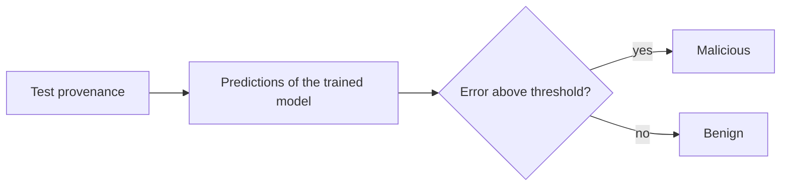
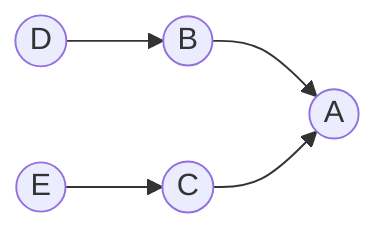

# Background

New to provenance-based intrusion detection? This page covers the concepts used throughout the documentation: system provenance, provenance graphs, and how PIDSs detect attacks with graph neural networks.
{ .lead }

## System provenance

**System provenance** is a detailed record of the activity of a computer system. Operating systems can be configured to capture it with their audit frameworks, such as Linux Audit or Event Tracing for Windows (ETW).

Provenance data captures:

- **Process execution**: which programs ran, with which arguments.
- **File operations**: reads, writes, creations, deletions.
- **Network activity**: connections and data transfers.
- **Inter-process communication**: pipes, signals, shared memory.

## Provenance graphs

Raw provenance logs are turned into a **provenance graph**: a directed graph whose nodes are system entities and whose edges are the interactions between them, with a timestamp.

### Node types

PIDSMaker uses three node types, each described by a textual label:

| Type | Entity | Label attributes |
|---|---|---|
| `subject` | Processes and threads | Executable path, command line |
| `file` | Files and directories | File path |
| `netflow` | Network connections | Remote IP address and port |

The attributes used in each label are set with `construction.node_label_features`.

### Edge types

Edges represent system calls or events. PIDSMaker uses 10 edge types:

| Edge type | Description |
|---|---|
| `EVENT_READ` | A process reads from a file |
| `EVENT_WRITE` | A process writes to a file |
| `EVENT_OPEN` | A process opens a file |
| `EVENT_EXECUTE` | A process executes a file |
| `EVENT_CONNECT` | A process connects to a remote host |
| `EVENT_RECVFROM` | A process receives network data |
| `EVENT_RECVMSG` | A process receives a network message |
| `EVENT_SENDTO` | A process sends network data |
| `EVENT_SENDMSG` | A process sends a network message |
| `EVENT_CLONE` | A process creates a child process (fork) |

## How PIDSs detect attacks

Labeled attacks are rare, so PIDSs use **self-supervised learning**: they learn what normal activity looks like, then flag what deviates from it.

**1. Training, on benign data only**

**2. Detection, on test data with attacks**

**Training.** The model learns the patterns of normal behavior from benign activity: which processes access which files, how they communicate over the network, which events usually follow each other. It is trained on a self-supervised task, such as predicting the type of each edge or reconstructing node features.

**Detection.** On the test data, the trained model makes the same predictions. A high prediction error means that the behavior was not seen in training. Entities, edges or time windows whose error exceeds a threshold, chosen on validation data, are flagged as malicious.

## Graph neural networks

Most PIDSs in PIDSMaker use **graph neural networks** (GNNs), neural networks designed for graph-structured data.

GNNs work by **message passing**: at each layer, every node aggregates information from its neighbors to update its representation. After *k* layers, the embedding of a node captures its *k*-hop neighborhood: below, A learns about its neighbors B and C after one layer, and about D and E, two hops away, after two.

PIDSMaker provides many GNN [encoders](../reference/encoders.md) (GraphSAGE, GAT, TGN, RGCN, graph transformers...) and self-supervised [objectives](../reference/objectives.md) (edge type prediction, node type prediction, feature reconstruction...), which can be combined freely.

## From concepts to PIDSMaker

PIDSMaker breaks every system into the same seven stages, from graph construction to evaluation and triage. Continue with:

- [Pipeline](pipeline.md): the stages and how they are cached.
- [Systems](systems.md): how the existing PIDSs map to these stages.
- [Datasets](datasets.md): the attack scenarios of each dataset.
