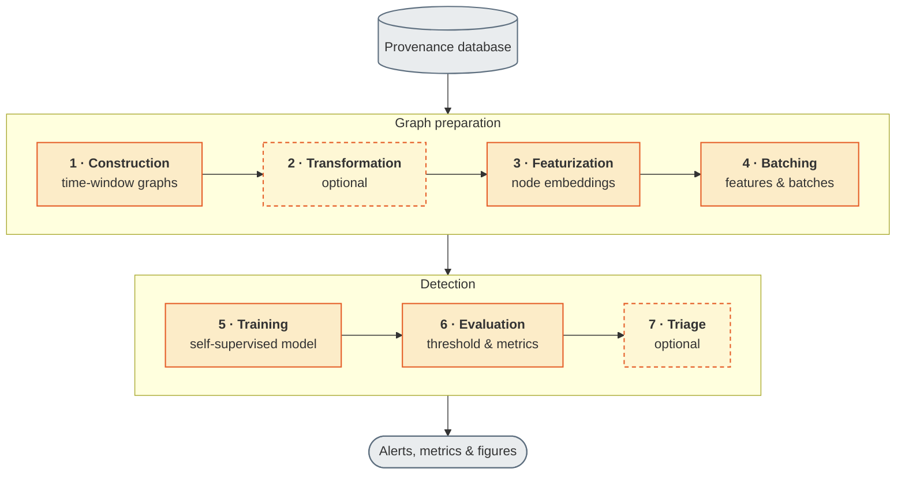
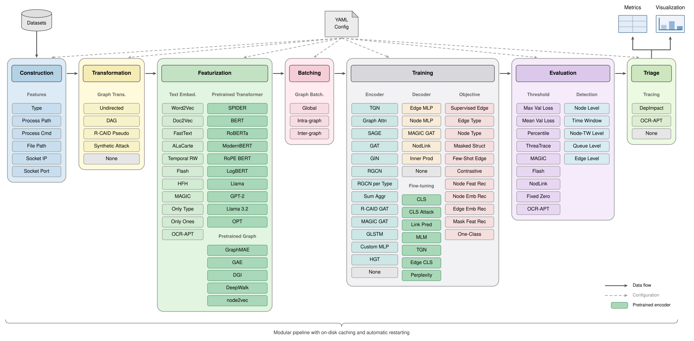

# Pipeline

PIDSMaker breaks every system into the same **seven stages**. Each stage is configured by a section of the system's YAML file in `config/`, so building a new PIDS amounts to picking a method, and its arguments, for each stage.
{ .lead }



??? info "All the methods available at each stage"
    [{ .figure-card }](../img/pipeline.svg)

    Generated from `pidsmaker/config/config.py`. Click to enlarge.

## The stages

<ol class="pm-steps" markdown>
<li markdown>**Construction** (`construction`): reads the events from the database, optionally [cleans](../reference/cleaning.md) them, and builds one provenance graph per time window (e.g. 15 minutes).</li>
<li markdown>**Transformation** (`transformation`): optional transformations of the graphs, applied in sequence: making them undirected, turning them into DAGs, building the R-Caid pseudo-graph, or injecting synthetic attacks.</li>
<li markdown>**Featurization** (`featurization`, then `feat_inference`): learns a text embedding model on the labels of the entities (word2vec, doc2vec, FastText, hierarchical hashing, a [pretrained encoder](../features/pretrained_encoders.md)...), then embeds every node.</li>
<li markdown>**Batching** (`batching`): selects the node and edge features, and builds the batches given to the model: [global, intra-graph and inter-graph batching](../features/batching.md), TGN neighbor sampling.</li>
<li markdown>**Training** (`training`): trains the encoder and the self-supervised objective on benign graphs, then computes the losses on the validation and test graphs.</li>
<li markdown>**Evaluation** (`evaluation`): turns losses into anomaly scores, picks a threshold on the validation set, and computes the metrics at the node, edge, time-window or queue level.</li>
<li markdown>**Triage** (`triage`): optional post-processing of the detections, to reconstruct attack paths (DepImpact) or anomalous subgraphs (OCR-APT) and reduce false positives.</li>
</ol>

All arguments of each stage are listed in the [Tasks reference](../reference/tasks.md).

## Where the code lives

```text title="Main files of the pipeline"
config/                         # one YAML file per system
├── orthrus.yml
├── kairos.yml
└── ...
pidsmaker/
├── main.py                     # the only entry point of the framework
├── factory.py                  # builds encoders, decoders, objectives from the config
├── config/
│   ├── config.py               # all available arguments (TASK_ARGS) and datasets
│   └── pipeline.py             # config parsing, task hashing and restarts
└── tasks/
    ├── construction.py         # 1. parse raw provenance + graph construction
    ├── transformation.py       # 2. graph transformations
    ├── featurization.py        # 3. train the text embedding model
    ├── feat_inference.py       # 3. embed the nodes
    ├── batching.py             # 4. batch construction, neighbor sampling
    ├── training.py             # 5. GNN training + inference
    ├── evaluation.py           # 6. thresholding, metrics and plots
    └── triage.py               # 7. optional attack reconstruction
```

## Caching of tasks

PIDSMaker computes a hash for each task from its arguments **and the arguments of all the tasks before it**. When a task completes, its outputs are saved on disk in a folder named after this hash.
On the next run, PIDSMaker recomputes the hashes: if a folder already exists, the task is skipped and its outputs are reused.

!!! example
    Running the same config twice: the first run executes every task (if nothing was run before with these arguments); the second skips them all, since their outputs already exist.

    Now change the text embedding size, `featurization.emb_dim`. The hashes of `construction` and `transformation` don't change, so their outputs are reused, and the pipeline resumes from `featurization`.


<small>With `--featurization.emb_dim=64`: the highlighted tasks are reused, the others run again.</small>

This makes experiments much faster: tuning the learning rate never rebuilds the graphs.

!!! warning "Avoid concurrent runs with identical early tasks"
    If two runs with the same `construction` arguments and dataset start at the same time, they write to the same folder. Start the first run and wait until its shared tasks are done before launching the others, or use `--restart_from_scratch`.

## Command line arguments

YAML files set the default arguments of a system, and CLI arguments override them:

```shell
python pidsmaker/main.py orthrus CADETS_E3 \
    --featurization.emb_dim=64 \
    --training.lr=0.0001
```

is equivalent to adding to the YAML config:

```yaml
featurization:
  emb_dim: 64
training:
  lr: 0.0001
```

New systems can inherit from an existing one with `_include_yml` and override only what changes:

```yaml title="config/my_system.yml"
_include_yml: magic

training:
  decoder:
    used_methods: predict_node_type
    predict_node_type:
      node_mlp:
        architecture_str: linear(0.5) | relu

evaluation:
  node_evaluation:
    threshold_method: nodlink
```

## Forcing a restart

During development, you may need to re-run tasks with the same arguments, for example after changing the code. `--force_restart` restarts the pipeline from a given task:

```shell
python pidsmaker/main.py orthrus CADETS_E3 --force_restart=featurization
```

!!! note
    A forced restart overwrites the outputs previously saved for the same tasks.

To run the whole pipeline without touching previous outputs, use:

```shell
python pidsmaker/main.py orthrus CADETS_E3 --restart_from_scratch
```

The outputs are then written to a new folder named after a random hash, isolated from all previous runs.

!!! warning
    Since the hash is random, these outputs can't be found again from the task arguments. All files produced with `--restart_from_scratch` are therefore deleted at the end of the run, to save disk space.
