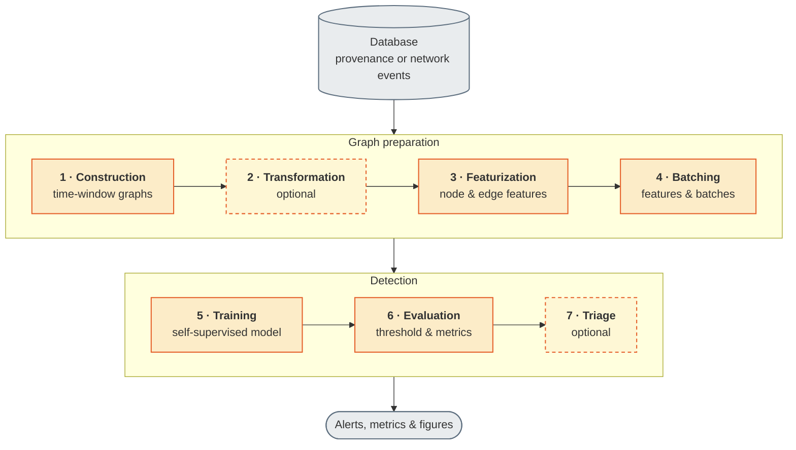

# Pipeline

PIDSMaker breaks every system, provenance-based or network, into the same **seven stages**. Each stage is configured by a section of the system's YAML file in `config/`, so building a new system amounts to picking a method, and its arguments, for each stage.
{ .lead }




## The stages

<ol class="pm-steps" markdown>
<li markdown>**Construction** (`construction`): reads the events of the dataset from the database, optionally [cleans](../reference/cleaning.md) them, and builds one graph per time window (e.g. 15 minutes). The dataset's schema (`pidsmaker/config/schemas.py`) defines its node types, edge types and event attributes.</li>
<li markdown>**Transformation** (`transformation`): optional transformations of the graphs, applied in sequence: making them undirected, turning them into DAGs, building the R-Caid pseudo-graph, merging repeated edges into weighted edges (`merge_edges`), or injecting synthetic attacks.</li>
<li markdown>**Featurization** (`featurization`, then `feat_inference`): learns a text embedding model on the labels of the entities (word2vec, doc2vec, FastText, hierarchical hashing, a [pretrained encoder](../features/pretrained_encoders.md)...) and embeds every node, or uses label-free features (`only_type`, `only_ones`). The attributes of events, if the dataset has any, are encoded as edge features.</li>
<li markdown>**Batching** (`batching`): selects the node and edge features, and builds the batches given to the model: [global, intra-graph and inter-graph batching](../features/batching.md), TGN neighbor sampling.</li>
<li markdown>**Training** (`training`): trains the encoder and the self-supervised objective on benign graphs, then computes the losses on the validation and test graphs.</li>
<li markdown>**Evaluation** (`evaluation`): turns losses into anomaly scores, picks a threshold on the validation set, and computes the metrics at the node, edge, time-window, queue or host level. See [Evaluation & labeling](evaluation.md).</li>
<li markdown>**Triage** (`triage`): optional post-processing of node-level detections, to reconstruct attack paths (DepImpact) or anomalous subgraphs (OCR-APT) and reduce false positives. See [Triage](../features/triage.md).</li>
</ol>

The methods available at each stage, and all their arguments, are listed in the [Reference](../reference/tasks.md).

## Provenance and network views

The same stages build provenance-based IDSs (PIDSs) and network IDSs (NIDSs). What changes is the data that flows through them, and the components that the systems of each family use by default:

<div class="pm-families" markdown>

| Stage | Provenance (e.g. Orthrus on `CADETS_E3`) | Network (e.g. Euler or LARES on `LANL`) |
|---|---|---|
| **Construction** | System events between processes, files and netflows, typed by system call (`EVENT_READ`, `EVENT_CONNECT`...). Raw data can be [cleaned](../reference/cleaning.md). | Authentications or flows between hosts, typed by their `operation` (`LogOn`, `FLOW_START`...) or by a categorical attribute (`construction.edge_type=logon_type`). `construction.operations` and `construction.drop_noise_events` select the events, and `construction.benign_training` drops the labelled malicious events of the train and val dates. |
| **Transformation** | Usually none; `undirected` (NodLink), `rcaid_pseudo_graph` (R-Caid). | `merge_edges`: the repeated edges of a window become one edge weighted by its count, optionally with aggregated attributes (counts per value, mean and std). |
| **Featurization** | Text embeddings of the labels of entities: file paths, command lines, IP addresses and ports. | Hosts only have a name or an ID (e.g. `C1065` in LANL): NIDSs use `only_type` or `only_ones`, and learn the identity of each host in the encoder. Event attributes are encoded as edge features: one-hot categorical and log-scaled numeric attributes, selected with `feat_inference.edge_attributes`. |
| **Batching** | Node features `node_emb,node_type`; edge features `edge_type` or TGN messages. | Edge features `edge_attrs` (Argus, LARES, E-GraphSAGE, Anomal-E). |
| **Training** | Predict the type of edges or nodes, or reconstruct node features. | Link prediction against negative edges (`predict_edge_contrastive`), edge autoencoder, Deep Graph Infomax; host identity and snapshot encoders (`node_id_embedding`, `snapshot_gru`). |
| **Evaluation** | Per node, against the attack nodes listed in ground-truth files (`node_evaluation`). | Per edge, against the malicious events labelled in the database (`edge_evaluation`), or host-centered (`host_two_stage_evaluation`). Epochs can be selected without labels (`best_val_score`, `last_epoch`). |
| **Triage** | DepImpact or OCR-APT subgraphs, from the detected nodes. | Not used: triage starts from node-level detections, and NIDSs detect edges. |

</div>

These are the defaults of each family, not restrictions: components work on both kinds of datasets, except those that need several node types or event attributes. See [Running across families](systems.md#running-across-families) and the [components of each system](systems.md#components-at-a-glance).

## Where the code lives

```text title="Main files of the pipeline"
config/                         # one YAML file per system
├── orthrus.yml
├── kairos.yml
└── ...
pidsmaker/
├── main.py                     # the only entry point of the framework
├── factory.py                  # builds encoders, decoders, objectives from the config
├── config/
│   ├── config.py               # all available arguments (TASK_ARGS) and datasets
│   ├── schemas.py              # node types, edge types and event attributes of datasets
│   └── pipeline.py             # config parsing, task hashing and restarts
└── tasks/
    ├── construction.py         # 1. read events + graph construction
    ├── transformation.py       # 2. graph transformations
    ├── featurization.py        # 3. train the text embedding model
    ├── feat_inference.py       # 3. embed the nodes
    ├── batching.py             # 4. batch construction, neighbor sampling
    ├── training.py             # 5. GNN training + inference
    ├── evaluation.py           # 6. thresholding, metrics and plots
    └── triage.py               # 7. optional attack reconstruction
```

## Caching of tasks

PIDSMaker computes a hash for each task from its arguments **and the arguments of all the tasks before it**. When a task completes, its outputs are saved on disk in a folder named after this hash.
On the next run, PIDSMaker recomputes the hashes: if a folder already exists, the task is skipped and its outputs are reused.

!!! example
    Running the same config twice: the first run executes every task (if nothing was run before with these arguments); the second skips them all, since their outputs already exist.

    Now change the text embedding size, `featurization.emb_dim`. The hashes of `construction` and `transformation` don't change, so their outputs are reused, and the pipeline resumes from `featurization`.


<small>With `--featurization.emb_dim=64`: the highlighted tasks are reused, the others run again.</small>

This makes experiments much faster: tuning the learning rate never rebuilds the graphs.

Arguments added in new versions of PIDSMaker are left out of the hash while they keep their default value, so the outputs computed before they existed are still reused after an update.

!!! warning "Avoid concurrent runs with identical early tasks"
    If two runs with the same `construction` arguments and dataset start at the same time, they write to the same folder. Start the first run and wait until its shared tasks are done before launching the others, or use `--restart_from_scratch`.

## Command line arguments

YAML files set the default arguments of a system, and CLI arguments override them:

```shell
python pidsmaker/main.py orthrus CADETS_E3 \
    --featurization.emb_dim=64 \
    --training.lr=0.0001
```

is equivalent to adding to the YAML config:

```yaml
featurization:
  emb_dim: 64
training:
  lr: 0.0001
```

New systems can inherit from an existing one with `_include_yml` and override only what changes:

```yaml title="config/my_system.yml"
_include_yml: magic

training:
  decoder:
    used_methods: predict_node_type
    predict_node_type:
      node_mlp:
        architecture_str: linear(0.5) | relu

evaluation:
  node_evaluation:
    threshold_method: nodlink
```

## Forcing a restart

During development, you may need to re-run tasks with the same arguments, for example after changing the code. `--force_restart` restarts the pipeline from a given task:

```shell
python pidsmaker/main.py orthrus CADETS_E3 --force_restart=featurization
```

!!! note
    A forced restart overwrites the outputs previously saved for the same tasks.

To run the whole pipeline without touching previous outputs, use:

```shell
python pidsmaker/main.py orthrus CADETS_E3 --restart_from_scratch
```

The outputs are then written to a new folder named after a random hash, isolated from all previous runs.

!!! warning
    Since the hash is random, these outputs can't be found again from the task arguments. All files produced with `--restart_from_scratch` are therefore deleted at the end of the run, to save disk space.

## Performance

The pipeline was optimized for speed and memory without changing its outputs: graphs, features, the batches given to the models, losses and metrics are identical to those of previous versions (GPU training is not bit-deterministic, so a few losses can differ by about 0.0001). Measured on full runs from scratch, before and after the optimizations:

| Run | Wall time | Peak RAM | Disk |
|---|---|---|---|
| Orthrus, THEIA_E5 | ~3.4 h → ~61 min | 370 → 16.6 GB | |
| Orthrus, CADETS_E3 | 42 → 20 min | 47 → 4.8 GB | 9.7 → 2.2 GB |
| Orthrus, optc_h201 | 95 → 29 min | 128 → 11.1 GB | 25.9 → 8.1 GB |
| Kairos, CADETS_E3 | 72 → 30 min | 14.4 → 4.7 GB | 4.5 → 1.6 GB |
| Kairos, optc_h501 | 191 → 39 min | 37 → 10.0 GB | 13.6 → 5.7 GB |

<small>Measured in [PR #77](https://github.com/ubc-provenance/PIDSMaker/pull/77); the CADETS_E3 and OpTC runs used A100 80 GB GPUs, and peak RAM is the resident memory of the largest process. On THEIA_E5, construction went from 824 to 204 s, `feat_inference` from 619 to 397 s, training (12 epochs) from 8,945 to 2,255 s and evaluation from 1,685 to 494 s.</small>

On the network datasets ([PR #78](https://github.com/ubc-provenance/PIDSMaker/pull/78)), merging the edges of the 205 graphs of `OPTC_NET` (LARES) went from ~77 to 4.5 min, the edge evaluation of one epoch (38M edges) from 658 to 58 s, and LARES on `OPTC_NET` end to end from more than 2 h to 15 min.

### Parallel graph construction

Graph construction builds the graphs of each day of the dataset in parallel processes. The number of processes is set with `--num_workers` (default: `min(8, #CPUs)`); it does not change the produced graphs, nor the task hashes.

```shell
python pidsmaker/main.py orthrus CADETS_E3 --num_workers 16
```

The graphs of the time windows are also transformed in `--num_workers` parallel processes, including by the R-Caid pseudo-graph (`rcaid_pseudo_graph`), whose random timestamps are drawn in window order from the same random state as in a sequential run, so that the transformed graphs are unchanged. The R-Caid transformation itself computes the descendants of the roots once per distinct set of successors, stops exploring those of the roots that will be pruned, and saves its edges without building networkx graphs: on CADETS_E3, the transformation task went from 371 to 6.5 s with 4 processes, with identical graphs.

### Shared node features

During training, node features (embeddings and types) are stored once in a shared table, and each batch only holds node IDs: its features are rebuilt on the GPU when the batch is used, with the same operations as before, so the model receives identical inputs. This divides the RAM used by the loaded graphs by about 4-6x (on CADETS_E3, from 11.9 to 1.9 GB with Orthrus and from 5.6 to 1.4 GB with Kairos), for roughly 10% more time per epoch and about 1 GB of GPU memory. Configurations whose node features depend on the graph (`only_ones`, `edges_distribution`), heterogeneous graphs, inter-graph batching and multi-dataset training keep storing features per batch. `--no_shared_node_features` disables the table.

!!! note "Deterministic database reads"
    Postgres sessions now disable synchronized scans (`synchronize_seqscans=off`), so that tables are always read in the same order. Runs are reproducible, but node embeddings can differ from those of runs made with previous versions on a server whose scans had drifted.

## Disk usage

Outputs are stored in compact formats, and all readers still accept the previous ones, so existing artifact folders keep working:

| Output | Format | Reduction |
|---|---|---|
| Graphs of construction and transformation | Compressed column arrays instead of pickled networkx graphs | ~5x smaller |
| Node features of `feat_inference` | Node feature rows and per-edge row indices instead of one message per edge | 6.1 → 0.9 GB on CADETS_E3 |
| Losses of each epoch | Compressed `.npz` instead of `.csv` | ~8x smaller |
| Edge scores of the edge evaluation (`edge_scores_*.pkl`) | int32 instead of int64 columns | ~35% smaller |

`torch.load` on a graph file still returns the identical networkx graph.

Evaluation also stores per-epoch pickles. To keep only the outputs of the best epoch once the pipeline has finished, use `--keep_best_epoch_only`. Stats and plots are kept for every epoch, but re-running evaluation afterwards only considers the kept epoch(s).

```shell
python pidsmaker/main.py orthrus CADETS_E3 --keep_best_epoch_only
```
